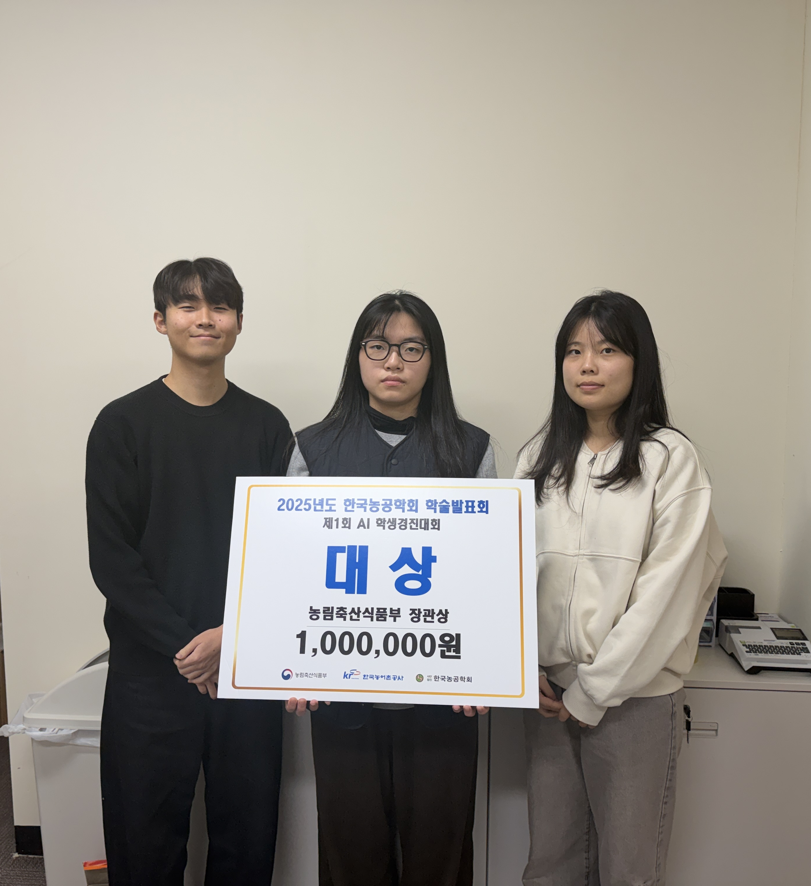

[← News](/news.html)

정재영, 석승원, 장은수 학생이 2025년도 한국농공학회 학술발표회에서 열린 KSAE AX-Water Challenge 2025(제1회 AI 학생경진대회)에서 대상인 농림축산식품부 장관상을 받았습니다. 시상은 2025년 10월 29일에 있었습니다.

## 연구 내용

과제명은 「농업용 저수지 수위 및 다출처 데이터를 활용한 저수지 운영 인공지능 모델 개발」입니다.

저수율, 저수량, 강수량 등 여러 출처의 자료를 모아 정리하고, LSTM과 GRU 모델로 저수지 수위를 예측했습니다. 예측 결과는 웹 대시보드로 볼 수 있게 만들어 저수지를 관리하는 사람이 바로 참고할 수 있도록 했습니다.

자세한 방법과 결과는 아래 포스터에 정리되어 있습니다.

